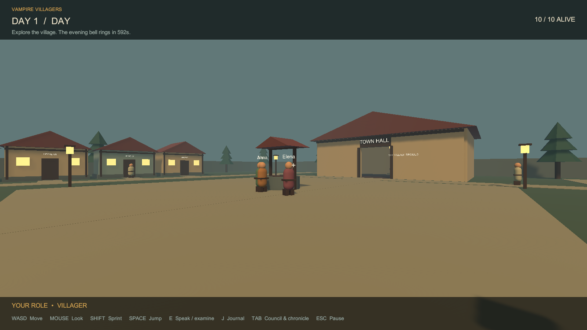
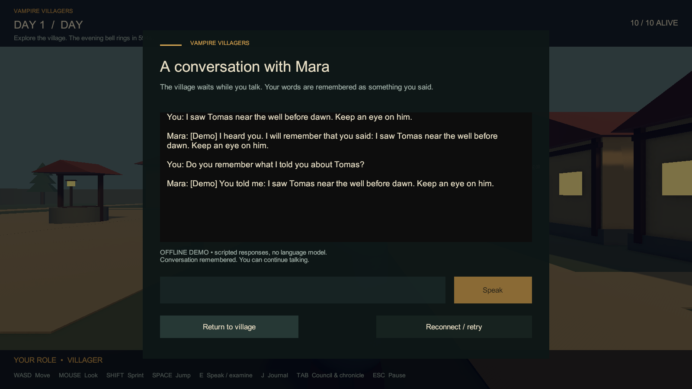
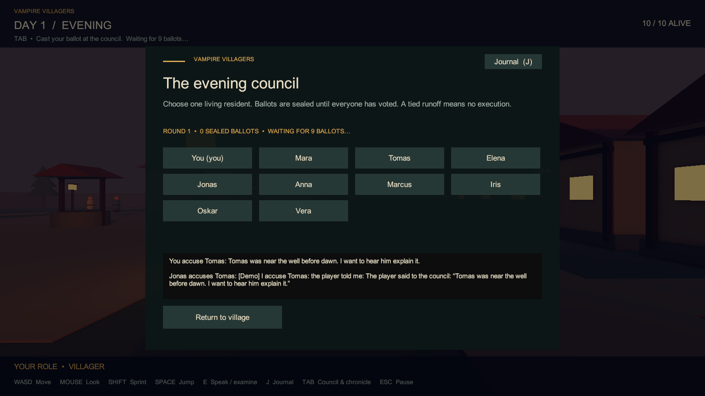
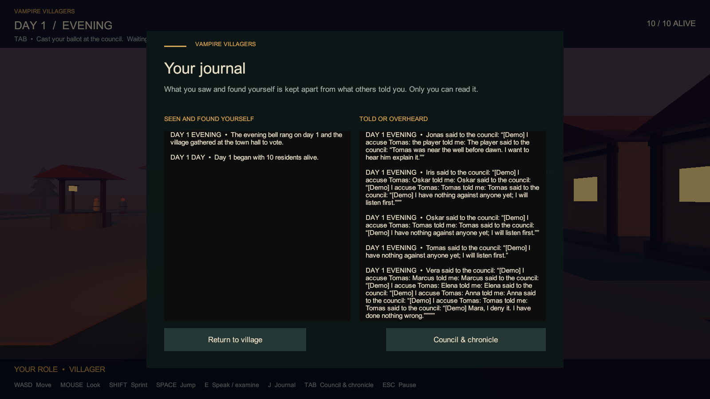
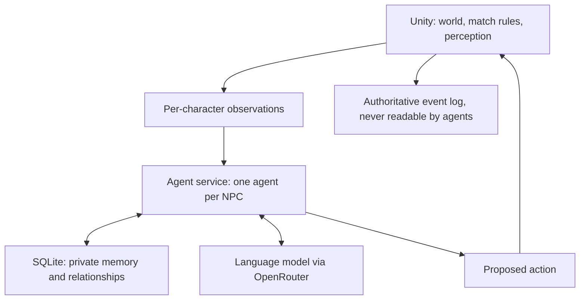

# Vampire Villagers

A first-person social deduction game set in a medieval village where **every villager is an independent AI agent** with its own personality, private memory, and relationships. One or two residents are secretly vampires. You explore, question people, attend the evening council, and vote, as a villager hunting the vampires or as a vampire hiding among them.

It is for players who like Werewolf/Mafia-style deduction and want a single-player version in which the other participants genuinely remember, gossip, accuse, and lie.

> **Status:** work in progress. Art is placeholder. The full source is private during development and **available for review on request**.

## How a match plays

| Phase | What happens |
| --- | --- |
| **Day** | Villagers plan their day, walk between the well, bazaar, town hall and homes, and talk to each other. You can speak to anyone in free text. People within earshot overhear. |
| **Evening** | Everyone gathers at the town hall. Each resident makes a public statement and may accuse someone; the accused defends themselves. Then everyone votes in secret, and the ballots are revealed together. |
| **Night** | The vampires confer in private and choose a victim, or spare the village. In the morning the body is found, with physical clues at the scene. |

The match ends when every vampire is dead or the vampires reach parity with the villagers.

## Current Features 

- A complete match from start to finish in either role, including tied votes, runoffs, observer mode after death, and a match summary.
- One persistent agent per villager, each with identity, personality, goals, searchable private memory, and relationships. Personality is assigned independently of role.
- Free-text conversation with any villager, and villager-to-villager conversations that spread information through the village.
- A journal that keeps what you saw or found yourself apart from what others told you.
- Clues created only by real events, never by something a character says.
- A vampire player sees their accomplice's suggestion and can whisper to them before choosing.
- Full offline play: if the agent service is unavailable, each decision falls back to scripted behaviour.

| | |
| --- | --- |
|  |  |
| Talking to a villager, who remembers what was said | The council: public statements and a sealed ballot |

*The journal separates first-hand records from testimony. These screenshots use the game's deterministic offline provider (lines marked `[Demo]`), which is used for testing without a language model; it shows the information flow rather than natural dialogue.*

## Architecture

| Layer | Technology |
| --- | --- |
| Game | Unity 6.3 LTS, C#, Universal Render Pipeline, Input System, uGUI |
| Rules | Engine-independent C# domain assembly, tested without the engine |
| Agent service | Python 3.11+, FastAPI, Pydantic, httpx |
| Storage | SQLite with FTS5 full-text search |
| Models | OpenRouter behind a replaceable provider interface|
| Tests | NUnit (Unity Test Framework) and pytest |

The game and the agents are deliberately separated. **Unity owns the truth**: positions, rules, votes, deaths, evidence. **The service owns reasoning**: memory, dialogue, plans. A model's output is always a *proposal* that the match rules validate before anything happens.

## Game Features

**Agents cannot know what they could not perceive.** The game appends everything that truly happens to an event log that no agent path can read. A separate set of perception rules decides who learns what: a character must be alive, awake, in the same zone, and within sight (14 m) or hearing (6 m). The identity of a night killer never enters any character's knowledge; the village only finds a body and clues at dawn. Tests assert this for every character after every kill.

**Testimony never becomes fact.** Every memory has a kind and a source. "I saw it", "I found it", "Tomas told me", and "I believe" are stored and retrieved differently, so a rumour repeated three times is still one claim with a chain of sources. When a villager passes something on, the attribution travels with it.

**Roles are enforced where they are stored.** The service refuses a night decision for a villager using only the role recorded when that agent was created. Nothing a later request says can grant it, and the refusal writes nothing to memory.

**Concurrency without chaos.** Each character's requests are strictly ordered; different characters run in parallel under a capacity limit. A small priority gate serves the waiting player before background villagers without preempting running work. Every request is idempotent, so a retry cannot cast a second ballot or repeat a killing.

**The game never waits on a model.** Councils and nights have deadlines. A slow, failed, or invalid decision falls back per resident to a scripted choice, and stale replies from an earlier phase are rejected.

**Testable without paying for inference.** A deterministic provider implements simple documented rules, which lets end-to-end tests show that a daytime claim changes a later vote and the vampires' night target, compared with a control match where nobody heard the claim.

## Source access

The full source is private while the project is in development. A source snapshot with setup and test instructions is available for review on request.
